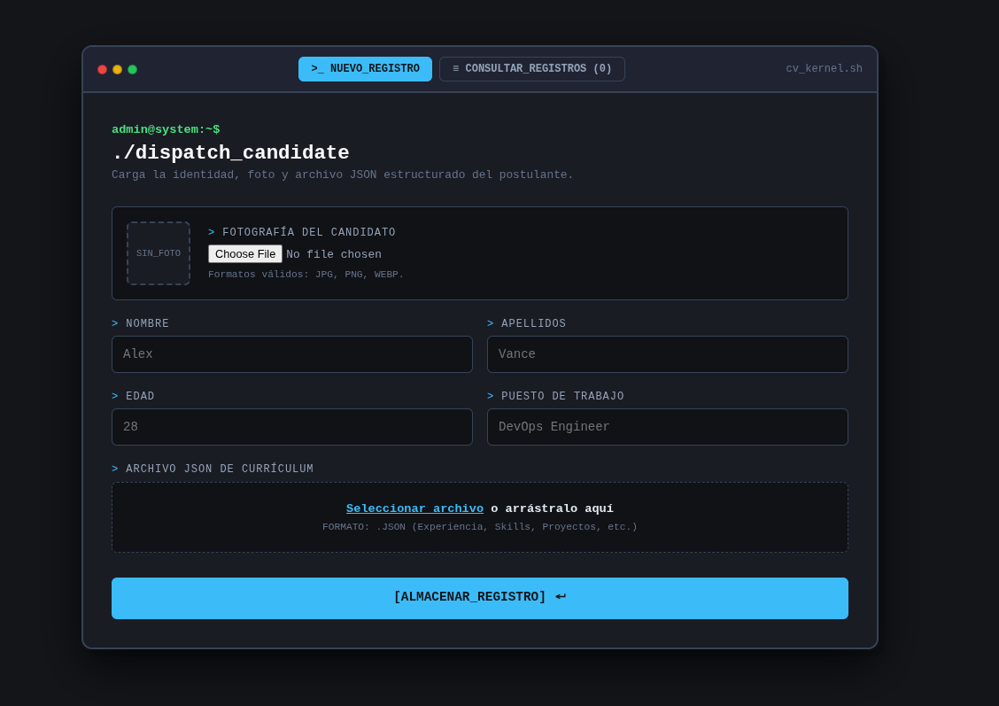

# Reto 2 Ethazi pagina

## Descripcion proyecto

Nuestro proyecto debe incluir una página HTML funcional y bien estructurada, adaptada a la gestión de CVs y candidatos, con formularios, metadatos SEO y un README que explique el proyecto y sus participantes. También debemos crear un diseño CSS atractivo y organizado, utilizando clases, Flexbox, Grid y otros recursos que mejoren la presentación y la usabilidad.

Debemos implementar JavaScript para validar formularios y añadir funcionalidades útiles, organizando el código en archivos externos y utilizando addEventListener. Además, podemos incorporar gestión de datos mediante JSON/XML, subida de archivos y respuestas de servidor con Python. Por último, debemos documentar la participación de todos los integrantes, incluir reflexiones, propuestas de mejora, comparar la idea inicial con el resultado final y entregar un proyecto funcional dentro del plazo.

### Añadimos

- formulario
- recibe el CV en json(es el formato que elegimos, no podemos parsear PDF)
- tiene los controles neceasrios
- Soporta un tipo multimedia, una imagen
- ETC

[Reto2 Pagina Repo](https://github.com/karensitauwu2006/reto2-pagina)

### Funcionamiento

La pagina tiene unos datos directos en el formulario, nombre, edad y puesto de trabajo,\
tambien tiene un envio de imagen y json. El json es el curriculum entero, ahi hay mas informaicon y esta mas detallada

# Participantes

- [x] Eneko Perez
- [x] Marco Manrique
- [x] Donald Garcia
- [] Unai Peña
